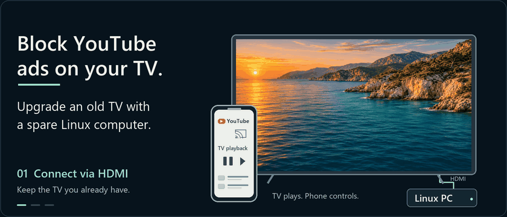
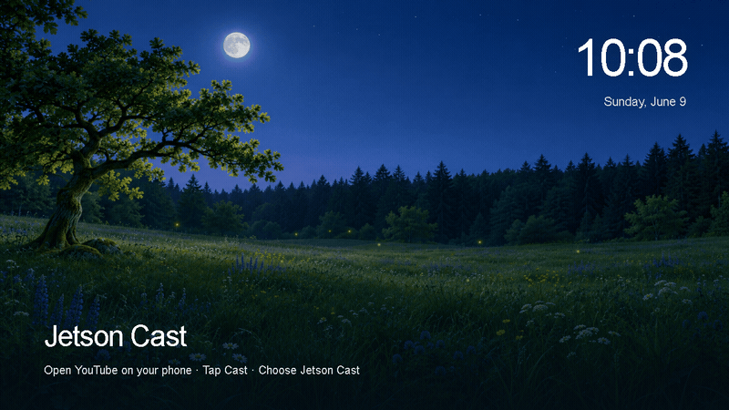

<div align="center">

<h1> JetsonCast</h1>

**Block YouTube ads on your TV with a spare Linux computer.**

Got an old laptop or mini PC lying around? Plug it into your TV. Older TVs without smart apps work too.

[Quick start](#quick-start) · [Device guides](devices/README.md) · [Demo kit](docs/media.md) · [Developers](docs/developers.md)

<a href="assets/previews/demo-landscape.mp4"></a>

**[Watch the 27-second demo](assets/previews/demo-landscape.mp4)** · [Vertical version](assets/previews/demo-vertical.mp4)

<sub>Illustrated phone controls · Actual screensaver artwork · Jet is optional</sub>

</div>

- **YouTube ad blocking** comes from VacuumTube. Optional SponsorBlock skips segments marked by its community. Ad blocking can change as YouTube changes.
- **Cast from the YouTube app.** The computer plays the video on your TV. Use your phone to search, queue and control playback without mirroring your screen.
- **Four animated screensavers** rotate when the receiver is idle, with the time and date. Want some company? Optional **fun mode** adds Jet's walks and surprise peeks.

## Quick start

Use a 64-bit Ubuntu desktop with Git and Python 3.10 or newer. Ubuntu 22.04 is the tested version. Connect the computer to your TV with HDMI or DisplayPort and put your phone on the same trusted network. [Check your device.](devices/README.md)

1. Select the TV input for the computer and open a terminal on the Ubuntu desktop.
2. Clone the repo and run setup. Choose a receiver name, the TV audio output, optional fun mode and whether to start the app when you log in.

   ```bash
   git clone --depth 1 https://github.com/R-M77/JetsonCast.git
   cd JetsonCast
   python3 install.py
   ```

3. Open **Jetson Cast** from the apps menu and finish the first-run prompts. In the YouTube app on your phone, tap **Cast**, then choose **Jetson Cast** or the name you picked.

Setup picks and verifies the ARM64 or x86-64 download. It runs as your regular user. [Troubleshooting](docs/compatibility.md#troubleshooting) · [Configure or uninstall](docs/compatibility.md#manage-your-installation)

## Which computers can run it?

No Jetson required.

| Device | Status | Setup |
| --- | --- | --- |
| Jetson Orin Nano 8GB | Casting, fullscreen video and TV audio verified on the earlier 2.0.1 build | [Jetson](devices/jetson-orin-nano/) |
| Intel / AMD mini PC | x86-64 build verified; TV playback untested | [Mini PC](devices/mini-pc/) |
| Old laptop or desktop | x86-64 build verified; TV playback untested | [PC](devices/x86-pc/) |
| Raspberry Pi 4 | Experimental; 2GB+ on Ubuntu 22.04, 4GB+ on 24.04 | [Pi 4](devices/raspberry-pi-4/) |
| Raspberry Pi 5 | Experimental; Ubuntu 24.04 Desktop, 4GB+ | [Pi 5](devices/raspberry-pi-5/) |
| Other ARM64 boards | Experimental; graphics and audio depend on the board | [ARM64](devices/generic-arm64/) |

Ubuntu 24.04 startup and Wayland playback are unverified. [Full compatibility](docs/compatibility.md) · [Validation](docs/validation.md)

Already running Pi-hole? A capable Ubuntu computer can run both. VacuumTube handles YouTube ad blocking on the TV, and Pi-hole handles DNS filtering for your network. [Run both on one computer.](docs/pi-hole.md)

<details>
<summary><strong>Optional fun mode: see Jet in action</strong></summary>



Fun mode is off by default. Enable it during setup or with `python3 install.py configure`, then close and reopen the app. Jet walks, hops down and peeks in from the edges while idle; he disappears when playback starts. Turn fun mode off for screensavers without the Easter eggs. [Screensaver preview](assets/moonlit-meadow.gif)

</details>

Codex and Claude Code skills are included for setup, troubleshooting and contributing. [Developer guide](docs/developers.md)

## Credits

[VacuumTube](https://github.com/shy1132/VacuumTube), by shy and contributors, provides YouTube playback, casting discovery and ad blocking. JetsonCast adds guided setup, TV audio routing, screensavers and Jet.

JetsonCast is an unofficial YouTube receiver. [Casting limits](docs/compatibility.md#casting-and-hdmi-inputs) · [Security](SECURITY.md) · [Contribute](CONTRIBUTING.md) · [Third-party credits](NOTICE.md) · [MIT license](LICENSE)
